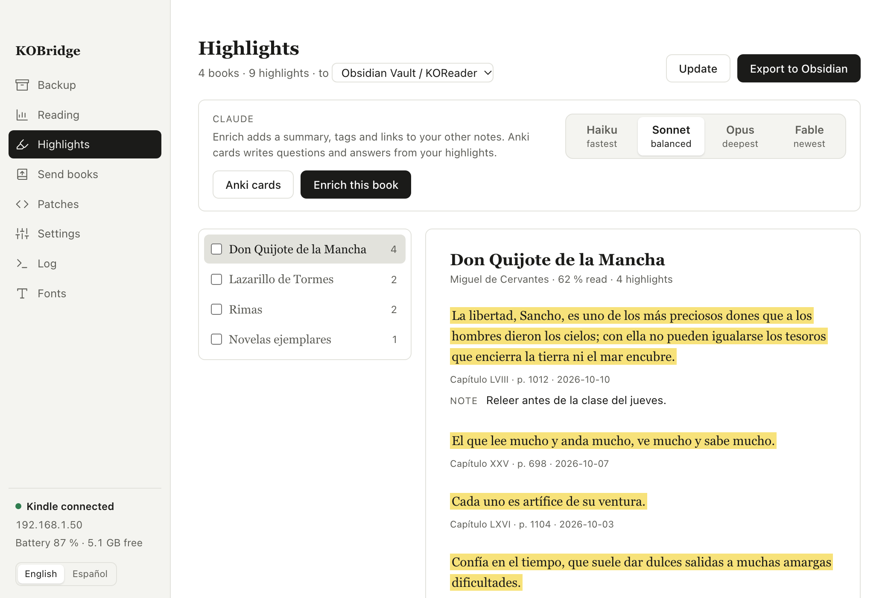
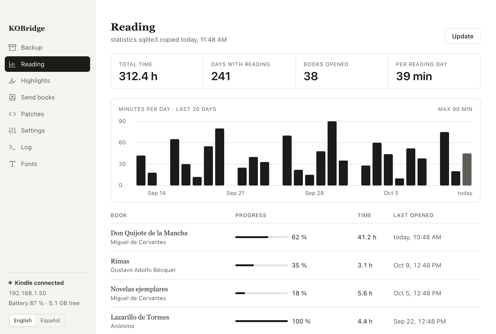
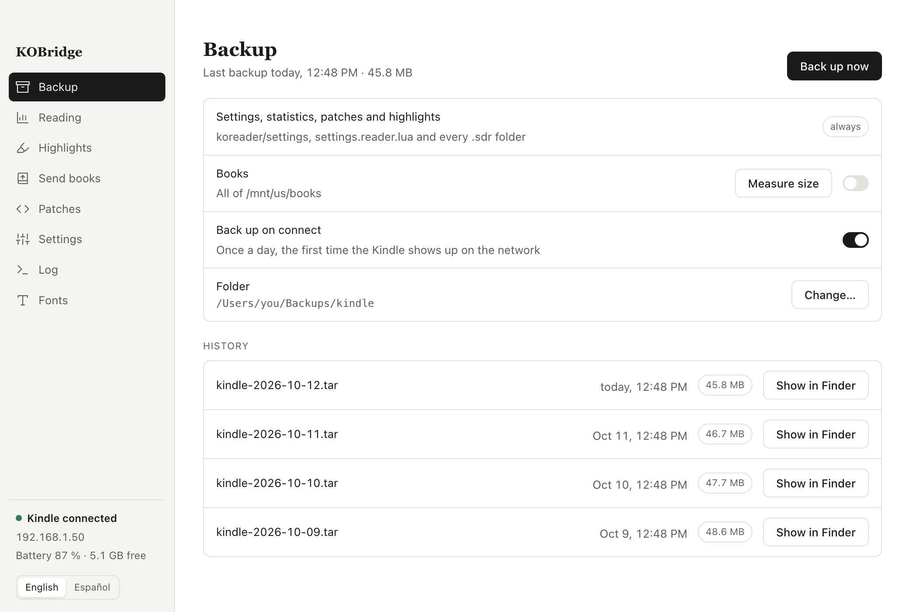
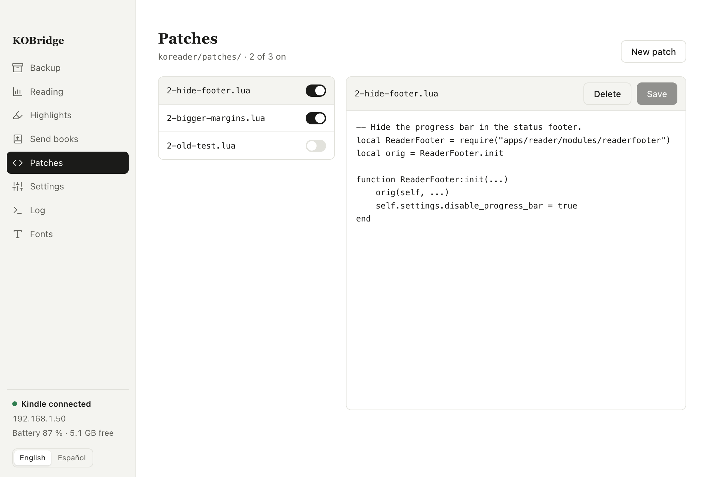

<p align="center">
  
</p>

<h1 align="center">KOBridge</h1>

<p align="center">
  A macOS app that manages KOReader on a jailbroken Kindle over Wi-Fi, using SSH instead of a USB cable.<br>
  Back up the Kindle, read your statistics, export highlights to Obsidian and Anki, and send books from your Mac.
</p>

<p align="center">
  <a href="#install">Install</a>&nbsp;&nbsp;&nbsp;
  <a href="#everything-it-does">Features</a>&nbsp;&nbsp;&nbsp;
  <a href="#set-up-the-kindle">Setup</a>&nbsp;&nbsp;&nbsp;
  <a href="#private-by-default">Privacy</a>&nbsp;&nbsp;&nbsp;
  <a href="#questions">Questions</a>&nbsp;&nbsp;&nbsp;
  <a href="#build-it-yourself">Build</a>
</p>

<p align="center">
  <a href="https://github.com/danihrndzld/KOBridge/releases/latest"></a>
  <a href="https://github.com/danihrndzld/KOBridge/releases"></a>
  <a href="#what-you-need"></a>
  <a href="https://tauri.app"></a>
  <a href="LICENSE"></a>
</p>

<p align="center">
  
  
  
  
</p>

KOBridge is a desktop app for people who read with [KOReader](https://koreader.rocks) on a Kindle and keep their notes on a Mac. It connects to the SSH server built into KOReader, so you can back up the device, see your reading statistics, export highlights, send ebooks and fonts, and edit KOReader settings without plugging in a cable. The app is built with Tauri 2, Svelte 5 and Rust, and it takes about 6 MB on disk. The interface is in English and Spanish, and you switch between them at the bottom of the sidebar.

## Everything it does

### Highlights and notes

- **Obsidian export.** KOBridge reads the highlights and notes of every book and writes one Markdown note per book into your Obsidian vault, plus a `Libros.md` index with progress and last reading date. It finds your vaults from Obsidian's own list, or creates a new vault if you don't have one.
- **Safe re-export.** Each highlight gets an Obsidian block id (`^kob-1a2b3c4d`). When you export again, the app adds only the new highlights at the end of the note and leaves the text you wrote by hand untouched.
- **Summaries with Claude.** If you have [Claude Code](https://claude.com/claude-code) installed, the app can add a summary, tags and links to related notes in your vault to each book note. You pick the model, Haiku, Sonnet, Opus or Fable, and the app limits Claude to reading and editing files inside the vault.
- **Anki flashcards.** Claude can turn the highlights of one or more books into question and answer cards. The app saves them as a text file that Anki imports into one deck per book, and importing the same book again updates the cards instead of duplicating them.

### Reading statistics

- **Dashboard.** The app copies KOReader's `statistics.sqlite3` and shows total hours read, days with reading, minutes per day for the last 30 days, and progress and time spent per book.
- **Offline.** KOBridge keeps a local copy of the statistics and highlights, so you can browse them while the Kindle is off.

### Backup

- **One file per backup.** KOBridge copies KOReader settings, statistics, user patches and the `.sdr` folders that hold your highlights into a `.tar` file on your Mac. You can include the books too.
- **Size estimate.** Before a backup, the app measures the real size with `du` and the Wi-Fi speed, so it can tell you how long the backup will take.
- **Daily backup.** If you turn it on, the app backs up once a day, the first time the Kindle shows up on the network.

### Books, fonts and KOReader settings

- **Send books.** Drag EPUB, PDF, MOBI, AZW3, FB2, CBZ, DjVu or TXT files onto the window, or pick them from a dialog, and the app copies them to `/mnt/us/books`.
- **Fonts.** Upload and delete `.ttf` and `.otf` fonts in `/mnt/us/fonts`.
- **User patches.** List, edit, create, turn on and turn off the Lua user patches in `koreader/patches`.
- **Settings files.** Edit `defaults.custom.lua` and `settings.reader.lua`. The app only saves `settings.reader.lua` while KOReader is closed, because KOReader overwrites that file when it exits.
- **Live log.** Follow `crash.log` as KOReader writes it, filter it, and show a message on the Kindle screen with `fbink`.

## Install

First, download the `.dmg` from the [latest release](https://github.com/danihrndzld/KOBridge/releases/latest) and drag KOBridge into Applications.

Second, open the app. KOBridge isn't signed with an Apple Developer ID, so macOS blocks it the first time. Right-click KOBridge in Applications and choose Open, or remove the quarantine flag in Terminal:

```sh
xattr -dr com.apple.quarantine /Applications/KOBridge.app
```

Third, when macOS asks whether KOBridge can find devices on your local network, allow it. Without that permission the app can't reach the Kindle, even when `ssh kindle` works in Terminal. You can change it later in System Settings, under Privacy & Security, Local Network.

The sidebar shows whether the app found the Kindle, its IP address, the battery level and the free space. If it can't find the Kindle, open Details to see the SSH error.

## Set up the Kindle

KOBridge stores no IP addresses or passwords. It runs the `ssh` command of your Mac with the host name `kindle`, so the whole connection lives in `~/.ssh/config`. You do these steps once.

### 1. Start the SSH server in KOReader

First, connect the Kindle to Wi-Fi. Second, in KOReader open the tools menu (the gear icon) and go to Network, then SSH server. Third, tap Start SSH server. The server listens on port 2222 and the user is `root`.

Network info in the same menu shows the IP address of the Kindle. Write it down for step 3.

### 2. Create an SSH key and copy it to the Kindle

KOReader accepts public keys in `koreader/settings/SSH/authorized_keys` on the Kindle. Create a key just for the Kindle on your Mac:

```sh
ssh-keygen -t ed25519 -f ~/.ssh/id_ed25519_kindle -C kindle
```

Then copy the contents of `~/.ssh/id_ed25519_kindle.pub` into `koreader/settings/SSH/authorized_keys` on the Kindle. The simplest way is to connect the Kindle over USB and paste the line into that file with a text editor. If the file doesn't exist, create it.

You can also turn on login without a password in the SSH server menu, connect once and copy the key over SSH. If you do, turn that option off as soon as you finish, because it leaves the Kindle open to anyone on your network.

### 3. Add the Kindle to `~/.ssh/config`

Add this block to `~/.ssh/config` and replace the IP address with the one of your Kindle:

```
Host kindle
  HostName 192.168.1.50
  Port 2222
  User root
  IdentityFile ~/.ssh/id_ed25519_kindle
  IdentitiesOnly yes
```

If the Kindle joins more than one Wi-Fi network, it gets a different IP address on each one, and SSH can pick the address that answers. Replace the `HostName` line with these `Match` blocks, and put them before `Host kindle`:

```
Match originalhost kindle exec "nc -z -G 1 192.168.1.50 2222 2>/dev/null"
  HostName 192.168.1.50
Match originalhost kindle exec "nc -z -G 1 10.0.0.70 2222 2>/dev/null"
  HostName 10.0.0.70

Host kindle
  HostKeyAlias kindle
  Port 2222
  User root
  IdentityFile ~/.ssh/id_ed25519_kindle
  IdentitiesOnly yes
```

SSH tries the addresses in order and uses the first one with port 2222 open. `HostKeyAlias kindle` makes SSH keep one fingerprint for every address, so it doesn't ask again each time you change networks.

### 4. Test the connection

Run this in Terminal:

```sh
ssh kindle 'cat /mnt/us/koreader/git-rev'
```

The first time, SSH asks you to confirm the fingerprint of the Kindle, and you answer `yes`. KOBridge can't answer that question for you, so run this test before you open the app. If the command prints the KOReader version, the setup is done.

### Default folders

The app saves backups in `~/Backups/kindle` and exports highlights to `~/Documents/Obsidian Vault/KOReader`. You can pick another vault in Highlights and another backup folder in Backup.

Anki cards go to `~/Downloads/KOReader Anki <date>.txt`, with a deck called `KOReader::<book>` for each book. Open Anki once to create your profile before you import them. The Open in Anki button opens the import dialog.

## Private by default

KOBridge has no account, no analytics and no tracking. The app only connects to your Kindle over SSH. Your highlights leave your Mac only when you press Enrich or Anki cards, and then Claude Code sends them to Anthropic under your own Claude login.

When Claude edits a note, the app runs `claude -p` inside your vault with only the Read, Glob, Grep and Edit tools. If the vault doesn't use git, the app saves a `.kob.bak` copy of each note before Claude edits it.

## What you need

- A Mac with Apple Silicon. The release only ships the `aarch64` build, but you can build the app for Intel from source.
- A jailbroken Kindle with KOReader installed. Follow the [KOReader installation guide for Kindle](https://github.com/koreader/koreader/wiki/Installation-on-Kindle-devices) if you don't have it yet. KOBridge was tested with KOReader v2026.07.1 on Kindle firmware 5.18.5.
- [Claude Code](https://claude.com/claude-code), signed in, for summaries and Anki cards. Everything else works without it.
- [Anki](https://apps.ankiweb.net) to import the flashcards.

## Questions

### Does it work with a Kindle that isn't jailbroken?

No. KOBridge talks to the SSH server that comes with KOReader, and KOReader only runs on a jailbroken Kindle.

### Does it work with Kobo or PocketBook?

It hasn't been tested. The app expects the Kindle paths `/mnt/us/books` and `/mnt/us/koreader`, so other devices need code changes.

### Can it restart KOReader after I change a patch or a font?

No. KOReader only restarts when it asks for it from inside, so you restart it on the Kindle yourself.

### Why does the message on the Kindle screen disappear?

The message that `fbink` writes stays on screen until KOReader redraws the page.

## Build it yourself

You need Rust, [Bun](https://bun.sh) and the Xcode Command Line Tools.

```sh
git clone https://github.com/danihrndzld/KOBridge.git
cd KOBridge
bun install
bunx tauri dev            # run the app in development mode
bunx tauri build          # build the .app and .dmg in src-tauri/target/release/bundle
bun run check             # check Svelte and TypeScript types
```

The Rust tests live in `src-tauri`:

```sh
cd src-tauri
cargo test                              # tests that don't need the Kindle
cargo test -- --ignored --nocapture     # tests against a real Kindle and Claude Code
```

The `--ignored` tests use your Kindle over SSH. They create test files in `/tmp` and in `koreader/patches` on the Kindle, and they delete them when they finish.

## License

KOBridge uses the [PolyForm Noncommercial License 1.0.0](LICENSE). You can read, change and share the source code, and you can use the app for any purpose that isn't commercial, e.g., personal reading, study, hobby projects, schools and charities. Selling the app or using it inside a commercial product needs separate permission, so open an issue if you want to ask.

Copyright 2026 Daniel Hernández.
